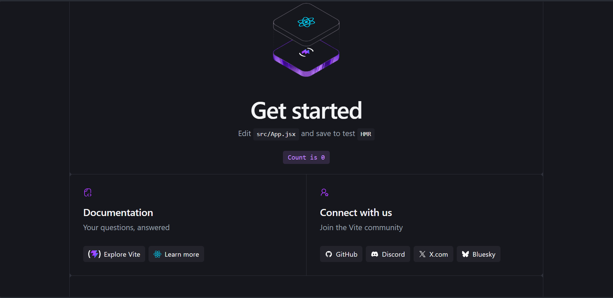
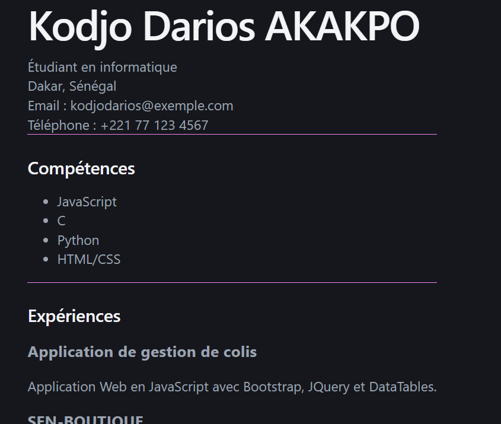

# TP REACT + VITE : Création d'un projet React avec Vite

## Objectif
Création d'un projet REACT nommé 001 avec l'outil de build Vite et documentation de son lancement

## Prérequis
- Node.js installé (version vérifiée avec `node -v`) : v24.16.0
- npm (vérifié avec `npm -v`) : 11.13.0
- Un éditeur de code (VS Code)

## Étapes de réalisation

### 1. Création du projet
```bash
npm create vite@latest
```
L'assistant pose plusieurs questions :
- **Project name** : `001`
- **Select a framework** : React
- **Select a Variant** : JavaScript
- **Which linter to use?** : ESLint, l'outil standard qui détecte les erreurs
  et applique des conventions de code. Cette question n'apparaissait pas dans
  le tutoriel que j'ai suivi : elle a été ajoutée dans les versions récentes de Vite.
- **Install with npm and start now?** : Yes

### 2. Installation des dépendances
Puisque j'ai répondu "Yes" à la dernière question, l'assistant a exécuté
automatiquement `npm install` (téléchargement des paquets listés dans
`package.json` et création du dossier `node_modules`), puis a lancé le
serveur de développement.

Le projet est accessible sur `http://localhost:5173`.




### 3. Lancement du serveur plus tard 
```bash
cd 001
npm run dev
```

## Rôle des dossiers et fichiers indispensables

### Dossiers

- **`node_modules/`** : contient toutes les bibliothèques téléchargées par `npm install`. 
  Il est généré automatiquement, on ne le modifie jamais et on ne l'envoie pas sur GitHub.
- **`src/`** : le dossier où j'écris le code de mon application. C'est ici que
  se fait presque tout le travail.
- **`public/`** : fichiers statiques (icônes, images) servis tels quels,
  sans être transformés par Vite.

### Fichier

- **`index.html`** : l'unique page HTML du projet. Elle contient une balise
  `<div id="root">` vide dans laquelle React affiche toute l'application,
  et charge `src/main.jsx`.
- **`src/main.jsx`** : le point d'entrée de l'application. Il récupère le
  `<div id="root">` et y affiche le composant `App`.
- **`src/App.jsx`** : le composant principal. C'est le fichier qu'on modifie
  pour construire l'interface.
- **`package.json`** : la carte d'identité du projet : son nom, la liste des
  dépendances et les scripts disponibles (`npm run dev` pour lancer le serveur,
  `npm run build` pour produire la version finale, `npm run lint` pour lancer ESLint).
- **`vite.config.js`** : la configuration de Vite (notamment l'activation du
  plugin React).
  
## Création du CV

Le CV est construit avec trois composants React, assemblés dans `App.jsx`.

### 1. Nettoyage du projet
J'ai supprimé le contenu de démonstration de Vite dans `src/App.jsx`
(logos, compteur, liens) pour ne garder que mon propre code.

### 2. Création des composants
J'ai créé le dossier `src/components/` avec trois fichiers :

- **`InfoPerso.jsx`** : nom, filière, ville, email et téléphone.
- **`Competences.jsx`** : un tableau de compétences affiché sous forme de liste
  avec `.map()`.
- **`Experiences.jsx`** : un tableau d'objets (`id`, `titre`, `description`)
  affiché avec `.map()`, avec une `key` unique pour chaque élément.

Chaque composant est une fonction qui retourne du JSX, et il est exporté
avec `export default`.

### 3. Assemblage dans `App.jsx`
Les trois composants sont importés puis utilisés comme des balises :

```jsx
<div className="cv">
  <InfoPerso />
  <Competences />
  <Experiences />
</div>
```

### 4. Mise en forme
Dans `src/index.css`, j'ai ajouté deux règles :
- `.cv` : limite la largeur, centre le bloc dans la page et aligne le texte à gauche.
- `.bloc` : ajoute un espace et un trait de séparation sous chaque section.

### Résultat



*Les coordonnées affichées sont fictives.*

## Auteur
Kodjo AKAKPO, L2 GL/ISI